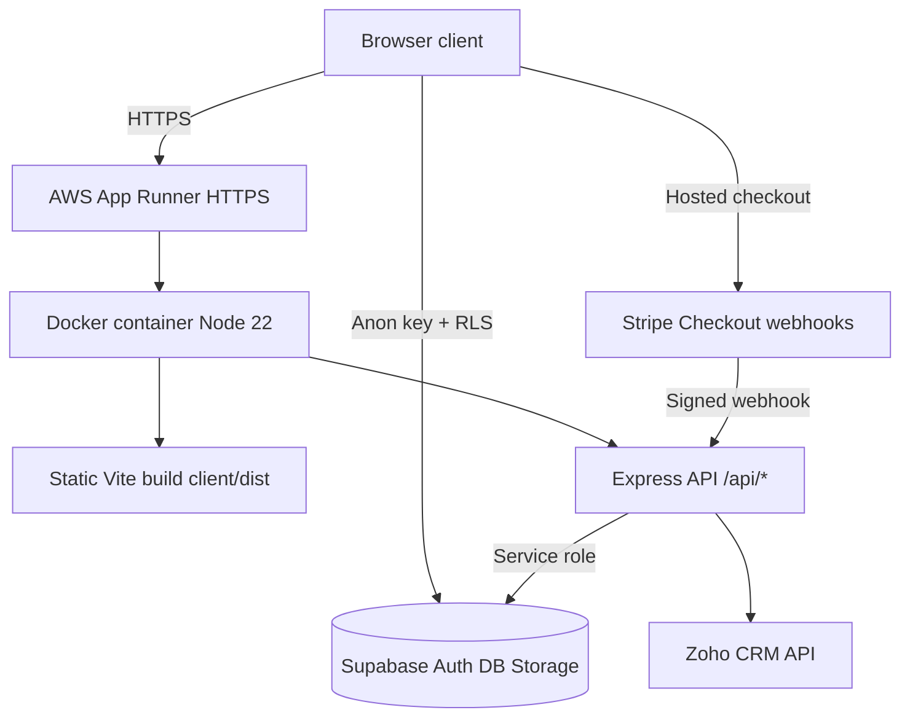

# Prospect client portal

React + Vite frontend, Node.js + Express backend, Supabase Auth/Postgres/private Storage, Stripe test Checkout, and Zoho CRM. With no credentials, the login page offers a clearly labelled visual preview. Preview data never creates an entitlement or a payment.

## Architecture guide

Read [Architecture and purchase flow](docs/ARCHITECTURE.md) for system and sequence diagrams, database relationships, security boundaries, API routes, implementation status, and reviewer checks. GitHub renders the Mermaid diagrams directly.

## AWS deployment (HTTPS)

Production uses a **single HTTPS URL** for both the React UI and the Express API. Supabase, Stripe, and Zoho stay external managed services; only the portal container runs in your AWS account.

### Architecture decision



| Layer | Choice | Why |
| --- | --- | --- |
| Compute | **AWS App Runner** | Managed HTTPS, health checks, no server patching; fits a small Node monolith |
| Packaging | **One Docker image** | Vite `client/dist` served by Express (`SERVE_STATIC=true`); same origin avoids CORS and simplifies `VITE_API_URL` |
| Registry | **Amazon ECR** | Private images for App Runner pulls |
| Data | **Supabase** (unchanged) | Assignment requires browser reads under RLS; no Postgres in AWS |
| Payments / CRM | **Stripe + Zoho** (unchanged) | Secrets only in App Runner env vars sourced from `server/.env` at deploy time |
| TLS | **App Runner default certificate** | `https://<id>.ap-south-1.awsapprunner.com` without buying a domain |

**Not in this deploy:** separate S3/CloudFront for the UI, custom domain (Route 53 + ACM), AWS Secrets Manager (env vars are injected from local `server/.env` during `deploy/aws/deploy.sh` — do not commit that file), or VPC-private networking.

### Deploy

Prerequisites: [AWS CLI](https://aws.amazon.com/cli/) configured, [Docker](https://www.docker.com/) running, filled `server/.env` and `client/.env` (same as local).

```sh
chmod +x deploy/aws/deploy.sh
./deploy/aws/deploy.sh
```

Default region: `ap-south-1` (override with `AWS_REGION`). After deploy, URLs are written to `deploy/aws/deployment-urls.txt`.

**Post-deploy checklist**

1. **Supabase Auth** → Site URL and redirect URLs: your App Runner `https://….awsapprunner.com` URL  
2. **Stripe** → Webhook endpoint: `https://….awsapprunner.com/api/webhooks/stripe` (test mode); update `STRIPE_WEBHOOK_SECRET` and redeploy  
3. **Zoho** → API domain must match your refresh token environment (see Zoho setup below)  
4. Re-run `./deploy/aws/deploy.sh` after any `server/.env` secret change  

Redeploy updates the same App Runner service with a new ECR image tag (`latest` by default).

## Run locally

Requires Node 20+ (Node 22 recommended for the API). From the repository root:

```sh
npm install
cp server/.env.example server/.env
cp client/.env.example client/.env
npm run dev
```

Frontend: http://localhost:5173. API: http://localhost:4000/api/health. Restart the frontend/backend after changing environment variables. No credentials are included. The Supabase service role and all Stripe/Zoho secrets belong only in `server/.env`. The browser uses only the Supabase public anon/publishable key.

## Supabase setup

1. Create a Supabase test project. Run `supabase/migrations/001_portal.sql` in its SQL editor **once**, or apply it using Supabase CLI migrations.
2. Set `SUPABASE_URL` and `SUPABASE_SERVICE_ROLE_KEY` in `server/.env`. Set `VITE_SUPABASE_URL` and `VITE_SUPABASE_ANON_KEY` in `client/.env`.
3. In Auth URL configuration set Site URL to `http://localhost:5173` and allow that redirect URL. Enable email/password authentication. Keep email confirmation enabled; configure SMTP if needed, or create confirmed test users from the dashboard.
4. Upload `documents/sample-guide.html` to the **private** `client-documents` bucket as `sample-guide.html`. Do not make the bucket public.
5. Register two test client accounts through the portal. Profiles are generated by a database trigger.
6. Create a separate Contact and Deal for each client in the Zoho test environment. Map each user to its Deal using the Supabase SQL editor (never let clients set their own mapping):

```sql
update public.profiles
set zoho_deal_id = 'YOUR_TEST_DEAL_ID'
where id = 'YOUR_SUPABASE_AUTH_USER_UUID';
```

All browser reads of purchase/access/audit status go directly to Supabase under RLS. Clients have select access only to their own records. Catalog metadata is shared; document bytes are private. Download links expire after 60 seconds and are bearer links until expiry.

## Stripe setup (when credentials are available)

1. In Stripe test mode/sandbox create a product and one-time price, e.g. INR 100. Set `STRIPE_PRICE_ID` and the `sk_test_...` key in `server/.env`. Live keys and live events are rejected.
2. Forward events with the Stripe CLI:

```sh
stripe listen --events checkout.session.completed,checkout.session.async_payment_succeeded --forward-to localhost:4000/api/webhooks/stripe
```

3. Set the CLI's `whsec_...` value as `STRIPE_WEBHOOK_SECRET` and restart the API. This secret differs from a dashboard webhook endpoint secret.
4. Make a purchase from the portal using Stripe's test card `4242 4242 4242 4242`, a future expiry, and any valid test CVC.
5. The success redirect **does not grant access**. The verified paid webhook validates the stored purchase's client, Deal, amount, currency, and session before calling a transaction that records the event, marks payment paid, grants access, and writes audit records.

No discounts, adjustable quantities, recurring prices, or automatic taxes are enabled: the checkout total must equal the configured price. Currency formatting assumes two minor-unit decimals for display; use INR/USD/EUR for this exercise.

## Zoho setup

Use the requested Developer Edition if you obtain access. The sandbox you created can be used for integration development; it is a separate environment and does not fulfill the exact Developer Edition requirement. Your current parent CRM trial expiry may affect sandbox availability.

1. Create a Deal custom picklist **Payment Status**, choices `Unpaid` / `Paid`, default `Unpaid`. Confirm its API name (normally `Payment_Status`) and set `ZOHO_PAYMENT_FIELD` accordingly. The integration sets this explicit field rather than assuming that Closed Won means paid.
2. Create a Self Client in the Zoho API Console for your account's data centre. Grant `ZohoCRM.modules.deals.READ,ZohoCRM.modules.deals.UPDATE` and select the correct **Sandbox or Developer organization**.
3. Exchange the short-lived grant code for access/refresh tokens. Put client ID, client secret, and refresh token into `server/.env`.
4. Set `ZOHO_ACCOUNTS_URL` and `ZOHO_API_DOMAIN` to match the token's region/environment. India sandbox defaults are supplied. Developer Edition in India uses `https://developer.zohoapis.in`. This code restricts API targets to test environments.
5. CRM failures do not revoke document access. The purchase displays pending, the client can click Retry sync, or an operator can run:

```sh
npm run retry -w server
```

## Validation

```sh
npm test
npm run build
```

Manual integration checks with configured services:

- Register/sign in as client A and buy the document. Check paid purchase, entitlement, audit events, and Paid in the mapped Deal.
- Resend the same Stripe webhook and another success event for the same checkout: only one entitlement and one normal CRM update occur.
- Remove Zoho credentials temporarily, buy as client B: access succeeds, CRM stays pending. Restore credentials and retry.
- In client B's browser try A's purchase UUID at `POST /api/purchases/:id/retry`: 404. Unpaid client download: 403. Direct Supabase reads return only the current client's records; inserts/updates of entitlements, purchases, profiles, audit logs, and RPCs are denied.
- Simultaneous retry requests: the database claim allows one active CRM attempt. Check expiry/retry behavior and rejected signature/live-payment/mismatched-ID tests.

## Architecture and tradeoffs

- Stable mappings: Auth user UUID → profile's unique Zoho Deal ID → purchase UUID → Stripe session metadata and client_reference_id. IDs, price, entitlement, and Deal selection are server controlled.
- Atomic payment processing uses a locked purchase row, unique event ID, and unique user/document entitlement. Repeated success webhooks do not invoke CRM again; pending jobs are recovered explicitly.
- CRM jobs use a database claim with a two-minute stale lease. Updates set a deterministic Paid value and suppress Zoho automation triggers. A crash after Zoho accepts an update but before recording success may repeat the external PUT on recovery. Exactly-once external API calls cannot be guaranteed without Zoho-side idempotency; the update is idempotent in effect.
- Audit logs record verified sessions, payments, entitlement grants, downloads, and CRM attempts. Session records mean server-verified portal session activity, not a comprehensive authentication security log. Failed login and identity-provider events are available in Supabase Auth logs. Browser clients cannot write or alter the audit table.
- No automated CRM scheduler is included; retry button and operator command satisfy recovery. Refund/chargeback access revocation, admin UI, MFA, password reset flow, webhook dead-letter dashboard, automated DB integration tests, and production deployment hardening are future work.
- Backend binds to localhost for development. Deployment needs HTTPS, controlled CORS, correct reverse-proxy rate-limit configuration, a private secret store, and a protected job runner. Do not expose the service role in a frontend build.

## 15-minute walkthrough

Show login and client isolation; trace checkout metadata and signed webhook; show the atomic payment SQL and browser Supabase reads; open the paid document; show Deal Payment Status; replay an event; demonstrate failed CRM + retry; show audit trail and explain the external exactly-once limitation.

Account provisioning and real integration verification are still required. This code has not been tested against your Stripe/Supabase/Zoho accounts without credentials. Track total exercise time and stop at the assignment's five-hour limit.
