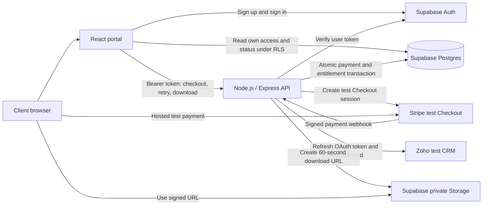
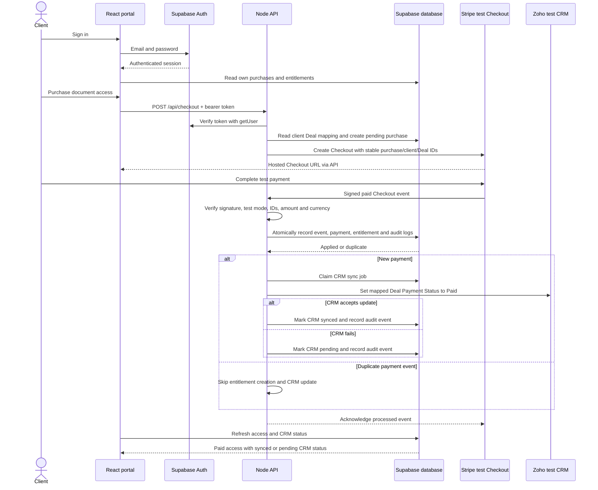
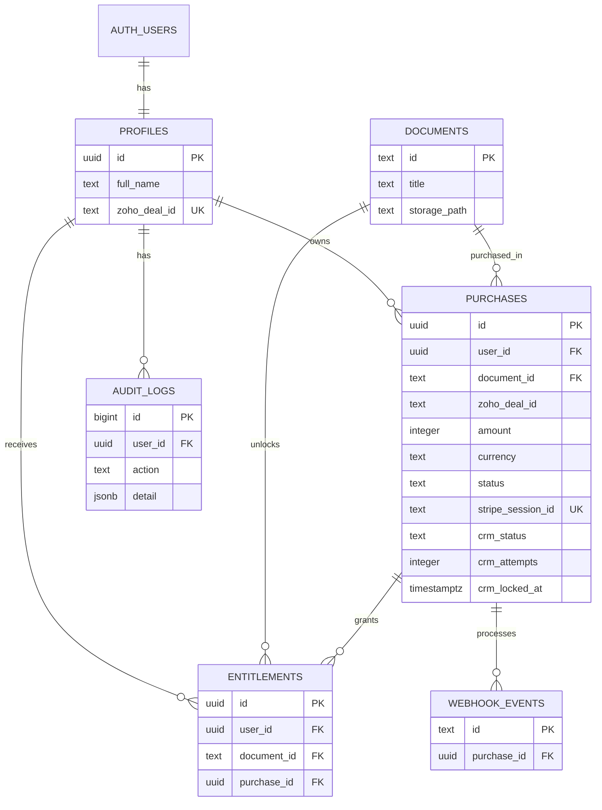

# Prospect portal: architecture and purchase flow

## Purpose

A client buys access to **The Client Launch Playbook**, a sample document, using Stripe test Checkout. A verified successful payment creates an entitlement in Supabase and updates the client's mapped Zoho CRM Deal to `Paid`.

The portal displays document access, purchases, CRM synchronization status, and an audit trail. Each client can retrieve only their own purchase records and entitled documents.

## Current implementation status

The Node.js backend, React frontend, SQL migration, and sample document are implemented. The frontend also offers a labelled design preview when Supabase credentials are absent. Preview data is illustrative and does not exercise authentication, payment, or CRM integrations.

Payment validation has 11 passing unit tests, the frontend production build passes, and the local dashboard was visually reviewed. Database migrations, RLS, storage permissions, and the full purchase journey still require verification against configured test services. Zoho sandbox provisioning is complete; access to the specifically requested CRM Developer Edition remains unresolved.

## System overview

The browser reads access status directly from Supabase, as required by the exercise. It uses a public Supabase key with the authenticated user's session; database policies enforce ownership. The service-role key, Stripe secret key, webhook secret, and Zoho credentials remain in the backend environment.

## Purchase sequence

The checkout success redirect is informational. Only the verified paid webhook grants access. The portal polls Supabase every 10 seconds and also supports a manual refresh.

## What is being sold?

The product is one-time access to the sample guide. The current document ID is `sample-guide`; the private storage object is `sample-guide.html`.

Create a one-time Stripe test price, such as INR 100, and configure `STRIPE_PRICE_ID`. The backend retrieves that price and stores its amount and currency on the purchase. The client cannot choose the payment amount, Deal ID, or entitlement. Pricing is configured in Stripe; the assignment does not prescribe an amount.

## Stable identity mapping

| Identifier | Source | Purpose |
| --- | --- | --- |
| Client UUID | Supabase Auth | Ownership and authenticated identity |
| Zoho Deal ID | Operator sets `profiles.zoho_deal_id` | Maps one test client to its CRM Deal |
| Purchase UUID | Backend/database | Correlates the intended purchase with payment |
| Checkout session ID | Stripe | Confirms which session belongs to the purchase |
| Stripe event ID | Stripe | Deduplicates webhook deliveries |
| Document ID | Server/catalog | Determines the purchased resource |

Stripe receives the client UUID in `client_reference_id` and the purchase UUID/Deal ID in session metadata. The webhook checks these values against the stored purchase, along with amount, currency, payment status, and any stored session ID. Email addresses are not used to match payment events to Deals.

## Data model

`entitlements` has a unique constraint on `(user_id, document_id)`. A partial unique index permits only one pending purchase for the same client/document. Profiles are generated from Supabase Auth using a database trigger. The Deal ID is copied onto each purchase so later profile mapping changes do not redirect an existing purchase.

## Payment and CRM states

| State | Meaning | Document access |
| --- | --- | --- |
| Purchase `pending` | Checkout has been requested; payment is unconfirmed | Locked |
| Purchase `expired` | An expired session was detected on another checkout attempt | Locked |
| Purchase `paid`, CRM `pending` | Payment transaction committed; CRM needs an update/retry | Granted |
| Purchase `paid`, CRM `syncing` | One worker holds the CRM claim | Granted |
| Purchase `paid`, CRM `synced` | Zoho accepted the update | Granted |

`apply_paid_checkout` locks the purchase and performs event recording, payment state change, entitlement creation, and audit inserts in one transaction. A failed transaction can be retried by Stripe. Duplicate event IDs or another success event for an already paid purchase do not trigger another CRM call.

CRM work runs after the payment transaction commits. `claim_crm_sync` permits one active attempt and allows recovery after a two-minute stale lease. Failed work returns to `pending`. The authenticated owner can retry through the portal; an operator can run `npm run retry -w server`.

### External update limitation

Zoho receives a deterministic update setting the configured payment field to `Paid`, with automation triggers suppressed. If Zoho accepts the update and the process crashes before recording success in Supabase, recovery may repeat the PUT. Normal webhook replay is deduplicated, but strictly exactly-once external API calls are not guaranteed without Zoho-side idempotency. The repeated update has the same intended effect.

## Security boundaries

| Boundary | Implementation |
| --- | --- |
| API identity | Backend verifies bearer token with Supabase `auth.getUser` |
| Client database reads | RLS restricts profiles, purchases, entitlements, and audit logs to the authenticated client |
| Protected database writes | Browser roles cannot insert/update protected tables or invoke payment/CRM RPCs |
| Download authorization | Backend checks the client's entitlement before generating a short-lived Storage URL |
| Webhook authenticity | Stripe SDK verifies the signature against the raw request body |
| Payment correctness | Backend validates stable IDs, stored price total, currency, test mode, and paid status |
| Credentials | Server environment holds privileged keys; `.env` files are excluded from Git |
| CRM ownership | Retry query filters by both purchase ID and authenticated user ID |
| API abuse | Request size limits, rate limiting for authenticated API routes, Helmet, and a configured CORS origin |

The Storage bucket is private and has no direct client object-read policy in this migration. A signed URL is a bearer capability that can be shared until its 60-second expiry; it is not tied to the requesting browser after issuance. Catalog metadata can be read by authenticated clients.

## API reference

| Method | Endpoint | Authentication | Behavior |
| --- | --- | --- | --- |
| GET | `/api/health` | Public | Reports API health and configured integrations, without secrets |
| POST | `/api/checkout` | Client bearer token | Creates or reuses the client's pending test Checkout session |
| POST | `/api/webhooks/stripe` | Stripe signature | Applies verified paid Checkout events |
| POST | `/api/purchases/:id/retry` | Purchase owner's bearer token | Retries CRM work for a paid purchase |
| GET | `/api/documents/:id/download` | Entitled client's bearer token | Returns a 60-second private document URL |
| POST | `/api/audit/login` | Client bearer token | Records a verified portal session event |

Access, purchase, profile, and audit reads use the browser's Supabase client directly, rather than duplicate API read endpoints.

## Audit trail

The application records `session.verified`, `payment.confirmed`, `access.granted`, `document.download`, `crm.pending`, and `crm.synced`. Clients can read their own audit records but cannot write or alter the audit table.

`session.verified` means that a portal session was verified by the server. It is not a complete identity-provider login log. Failed authentication events should be reviewed in Supabase Auth logs. Downloads record URL issuance, not proof that the browser fetched the document bytes. Payment and access audit events are committed with the payment transaction.

## Repository map

| Path | Responsibility |
| --- | --- |
| `client/src/main.jsx` | Login/signup, direct Supabase reads, dashboard, purchase, download, CRM retry, preview |
| `client/src/style.css` | Responsive visual design |
| `server/src/index.js` | Express routes, token checks, Checkout, webhook handling, download authorization |
| `server/src/payment.js` | Payment-to-purchase validation |
| `server/src/zoho.js` | OAuth refresh, claimed CRM updates, pending/synced results |
| `server/src/config.js` | Server configuration and integration clients |
| `server/src/retry.js` | Operator command for pending/stale CRM jobs |
| `supabase/migrations/001_portal.sql` | Tables, constraints, RLS, auth trigger, RPCs, private bucket |
| `server/test/payment.test.js` | Payment mapping unit tests |
| `documents/sample-guide.html` | Sample paid-access resource |
| `README.md` | Setup, commands, environment variables, and walkthrough |

## Reviewer verification checklist

After connecting the services and applying the migration:

1. Register two test clients and assign each a different test Deal.
2. Purchase as client A and trace session metadata → webhook → purchase → entitlement → Zoho payment field.
3. Replay the webhook and verify one entitlement and no additional normal CRM update.
4. Temporarily make Zoho unavailable. Verify access succeeds, CRM stays pending, and retry recovers.
5. Attempt client A's purchase retry as client B; expect 404. Attempt an unpaid document download; expect 403.
6. Verify direct Supabase queries reveal only the signed-in client's protected records and deny client writes/RPC execution.
7. Inspect audit events and confirm the document bucket is private.

Run `npm test` and `npm run build` for the existing automated checks. These do not replace database and external-service integration testing.

## Remaining work and exercise scope

Credentials, database provisioning, Storage upload, client-to-Deal mappings, and a complete external test purchase remain required. The exact Zoho Developer Edition requirement also remains open.

Future work includes refunds/chargebacks and access revocation, automated CRM scheduling, password reset/MFA, administration screens, broader database/concurrency tests, and production deployment hardening. The backend currently binds to localhost. Production requires HTTPS, appropriate proxy/rate-limit configuration, and managed secrets.

The exercise asks for test data and test payments only, no committed credentials, a submission within seven calendar days, and no more than five hours total including account setup. Audit logs are an additional implementation feature. The 15-minute review should demonstrate the purchase flow and explain completed work, limitations, and next steps.
